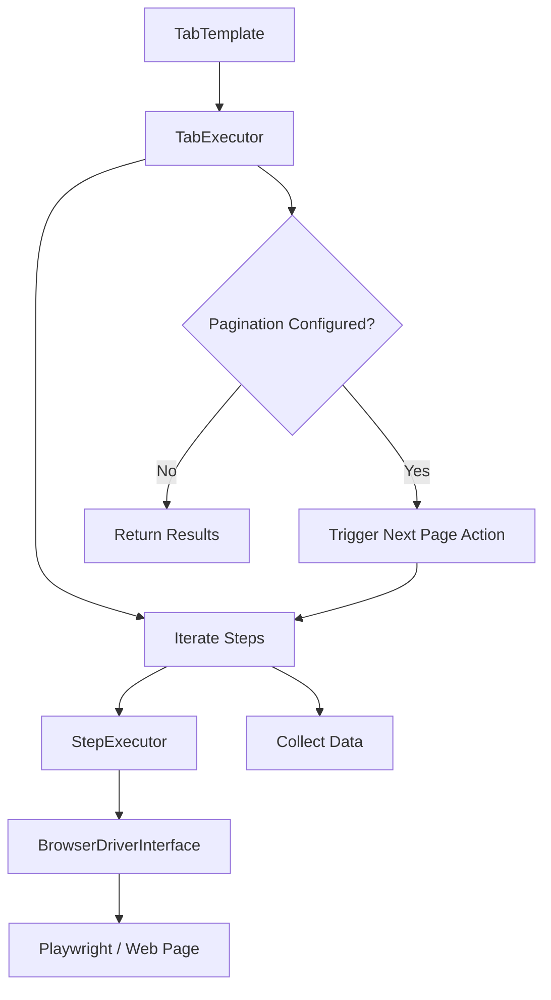

# What is StepWright PHP?

**StepWright PHP** is a declarative, step-by-step browser automation and web scraping framework built for PHP 8.2+.

Instead of writing imperative Playwright script logic, StepWright allows you to define workflows as structured data templates using strongly typed Data Transfer Objects (DTOs) or array configurations.

## Key Concepts

- **StepWright**: The main orchestrator class (`StepWright::runScraper`) that executes templates using a browser driver.
- **TabTemplate**: Defines a tab sequence, including its initial navigation step, execution steps, and pagination rules.
- **BaseStep**: Represents an individual action (e.g., `navigate`, `click`, `fill`, `getTitle`, `loop`, `writeData`, `custom`).
- **BrowserDriverInterface**: Abstraction interface over Playwright or headless browser drivers.

## Workflow Execution Flow

